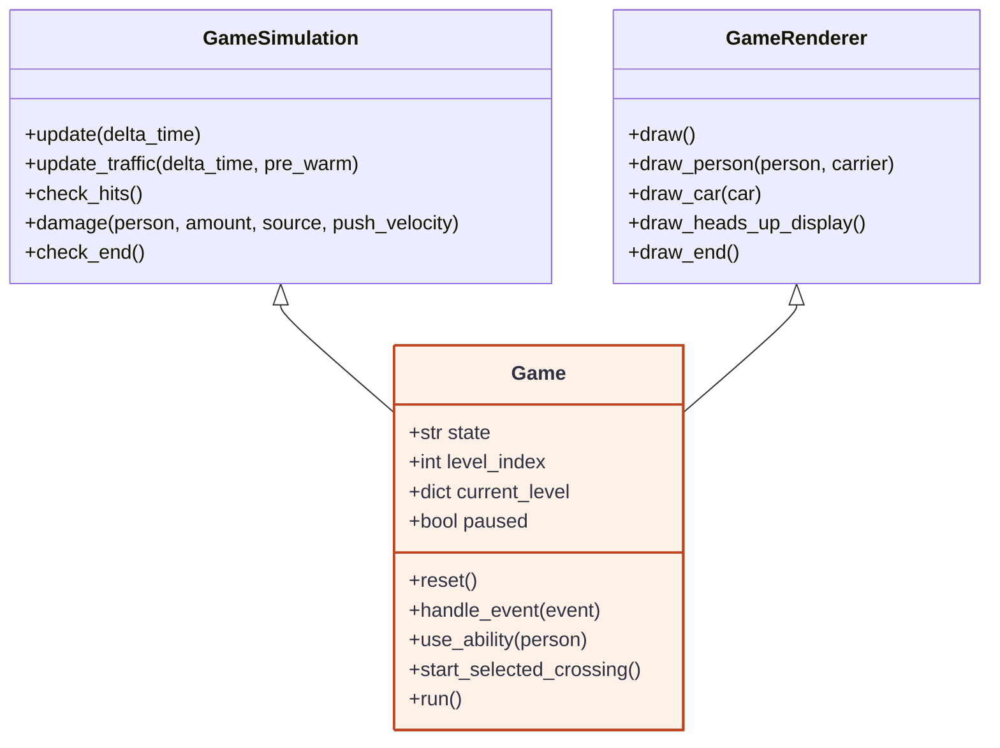
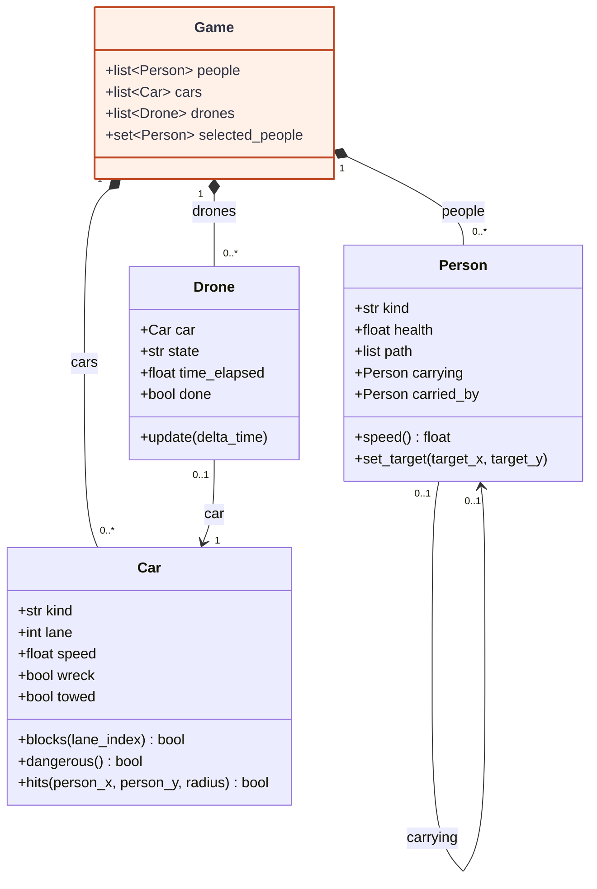
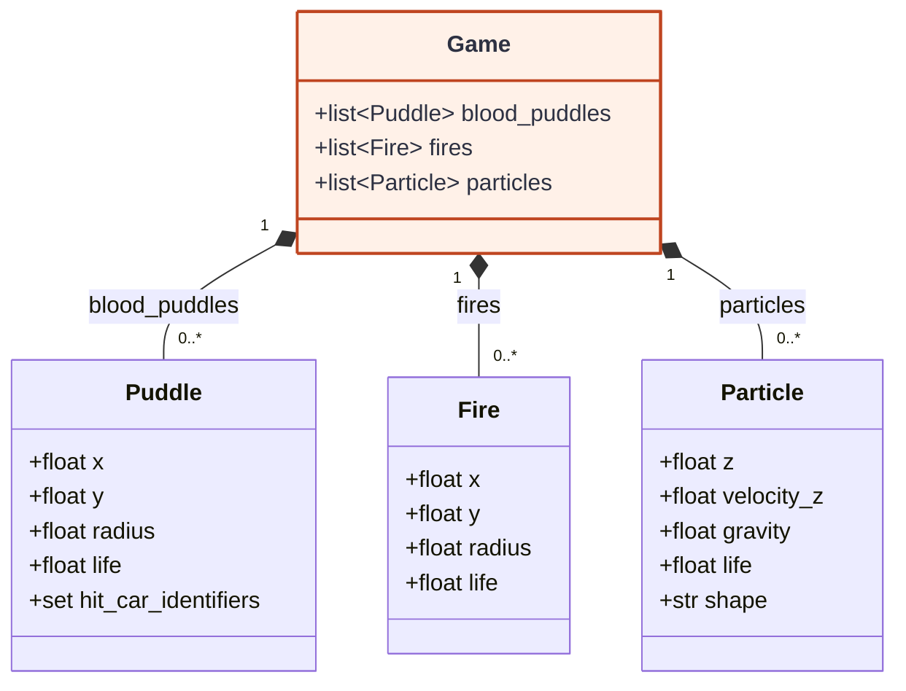

# Class Diagram — Cross the Road

`Game` เป็นศูนย์กลางของเกม: รับอินพุต เก็บสถานะ และสืบทอดพฤติกรรมจาก `GameSimulation` กับ `GameRenderer` ส่วนตัวละคร รถ โดรน และเอฟเฟกต์เป็นออบเจ็กต์ที่เกมจัดการ

## 1. โครงสร้างหลัก — ใครควบคุมเกม

อ่านจากบนลงล่าง: คลาสแม่ให้พฤติกรรม แล้ว `Game` รวมพฤติกรรมเหล่านั้นบนสถานะเดียวกัน

| คลาส | รับผิดชอบ | ไฟล์ |
| --- | --- | --- |
| **Game** | ตั้งค่าเกม รับคำสั่งผู้เล่น และควบคุม game loop | [cross_the_road.py](../cross_the_road.py) |
| GameSimulation | เดินเวลา เคลื่อนที่ ตรวจชน และตัดสินผลด่าน | [simulation.py](../simulation.py) |
| GameRenderer | อ่านสถานะแล้ววาดฉาก ตัวละคร รถ และ UI | [rendering.py](../rendering.py) |

`GameSimulation` และ `GameRenderer` ทำงานเป็น mixin: เมธอดใช้ `self` ของ `Game` โดยตรง ไม่มีออบเจ็กต์ simulation หรือ renderer แยกต่างหาก

## 2. คนและการจราจร — เกมเก็บอะไร และใครอ้างถึงใคร

`Game` จัดการคน รถ และโดรน ส่วน `Drone` อ้างถึงรถเป้าหมาย และ `Person` อ้างถึงคนที่อุ้มหรือคนที่อุ้มตนอยู่

- **Person** เก็บสุขภาพ เส้นทาง และสถานะตัวละคร การชนและความเสียหายจัดการโดย `GameSimulation`
- **Car** รู้ขนาดและสถานะของตนเอง รวมถึงตรวจว่าทับเลนหรือชนตำแหน่งคนหรือไม่
- **Drone** มี `update()` ของตนเองเพื่อบินเข้า เกี่ยวรถ ยก และนำรถออกจากฉาก รถเป้าหมายยังเป็นออบเจ็กต์เดียวกับใน `Game.cars`
- `carrying` กับ `carried_by` เป็นลิงก์กลับกัน และเป็น `None` ได้ ส่วน `selected_people` อ้างถึงคนเดิมใน `people`

## 3. เอฟเฟกต์ในโลกเกม — ข้อมูลที่มีอายุจำกัด

เอฟเฟกต์ทั้งสามชนิดเก็บข้อมูลเป็นหลัก: `GameSimulation` อัปเดตและลบเมื่อหมดอายุ ส่วน `GameRenderer` นำข้อมูลไปวาด

| คลาส | ความหมายในเกม |
| --- | --- |
| Puddle | คราบเลือดหรือไอศกรีมที่ทำให้ลื่น บันทึกรถที่ได้รับผลไปแล้ว |
| Fire | พื้นที่ไฟไหม้ กำหนดตำแหน่ง รัศมี และอายุ |
| Particle | เศษชิ้นส่วน ควัน หรือประกาย มีตำแหน่ง ความเร็ว แรงโน้มถ่วง และอายุ |

Person, Car, Drone, Puddle, Fire และ Particle อยู่ในไฟล์ entities.py ส่วน Game อยู่ในไฟล์ cross_the_road.py