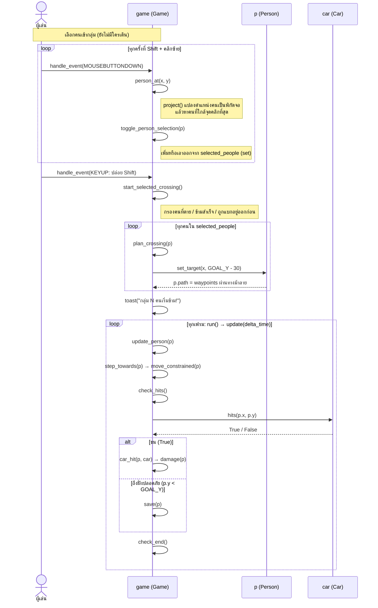

# Sequence diagram — เลือกกลุ่มแล้วข้ามพร้อมกัน (Shift-click)

ฉากนี้คือ feature ที่ใช้ในพรีเซนต์: ผู้เล่นกด Shift ค้างแล้วคลิกเลือกหลายคน
พอปล่อย Shift ทุกคนในกลุ่มเริ่มเดินในเฟรมเดียวกัน จากนั้น game loop
ขยับคน ตรวจการชน และเช็กแพ้ชนะทุกเฟรม

## ไฟล์และฟังก์ชันที่เกี่ยวข้อง

| ขั้นตอน | ฟังก์ชัน | ไฟล์ |
|---|---|---|
| รับคลิกและปุ่ม | `Game.handle_event()` | `cross_the_road.py` |
| หาคนที่ถูกคลิก | `Game.person_at()`, `project()` | `cross_the_road.py`, `geometry.py` |
| เลือก / เริ่มข้ามเป็นกลุ่ม | `toggle_person_selection()`, `start_selected_crossing()` | `cross_the_road.py` |
| วางเส้นทางผ่านทางม้าลาย | `Game.plan_crossing()`, `Person.set_target()` | `cross_the_road.py`, `entities.py` |
| ขยับคนทุกเฟรม | `update_person()`, `step_towards()`, `move_constrained()` | `simulation.py` |
| ตรวจการชน | `check_hits()`, `Car.hits()`, `car_hit()`, `damage()` | `simulation.py`, `entities.py` |
| ถึงฝั่ง / จบด่าน | `save()`, `check_end()` | `simulation.py` |

หมายเหตุ: `Game` สืบทอดจาก `GameSimulation` และ `GameRenderer` ฟังก์ชันใน
`simulation.py` จึงถูกเรียกผ่าน `self` ของ object `game` ตัวเดียวกัน
ใน diagram เลยแสดงเป็นลูกศรที่ชี้กลับเข้าหา `game`
